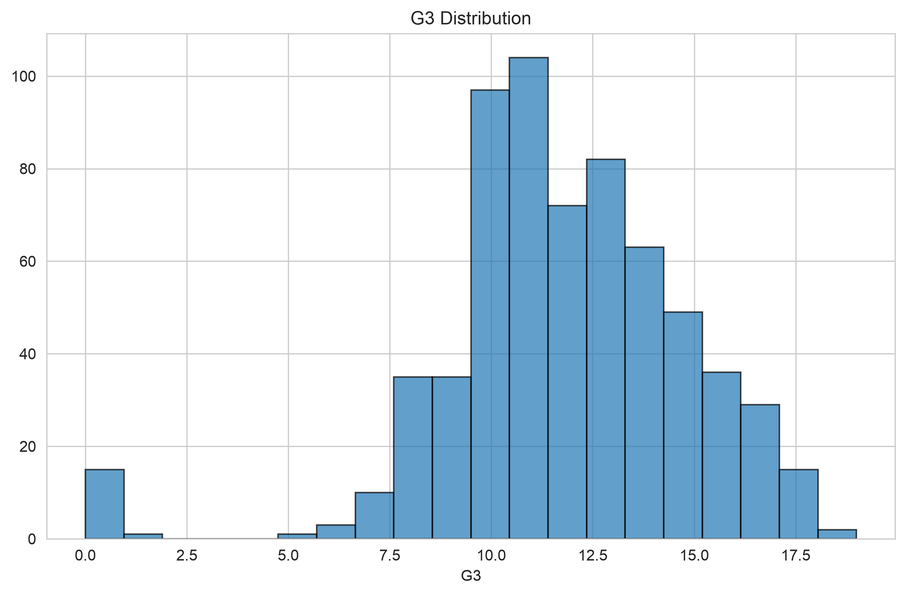
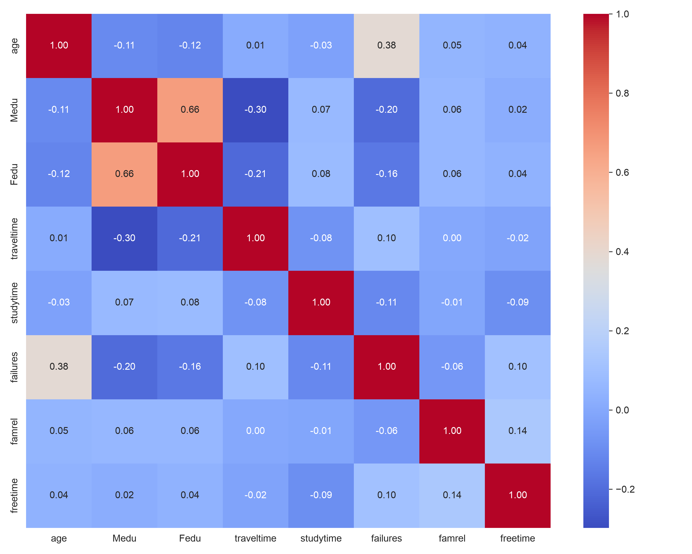
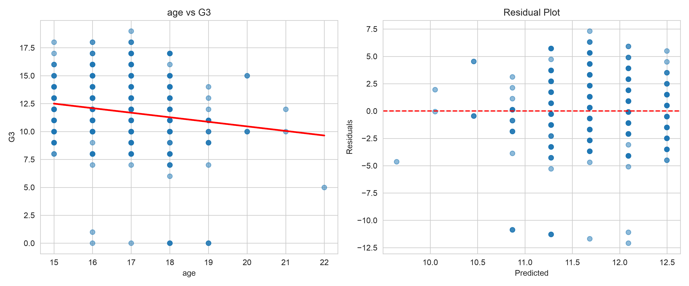
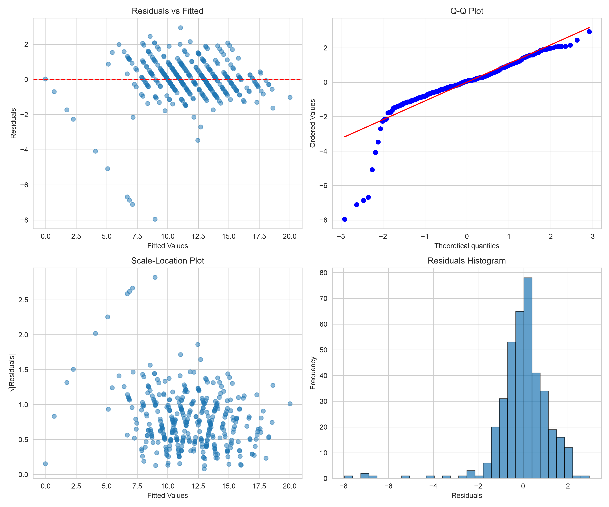

# Лабораторная работа №2: Линейная регрессия

## Описание
Построение и анализ моделей простой и множественной линейной регрессии для прогнозирования успеваемости студентов. Экспериментальная проверка гипотез о влиянии предобработки, полиномиальных признаков и регуляризации на качество моделей.

## Датасет
**student-por.csv** — данные об успеваемости студентов по португальскому языку
- Наблюдений: 649
- Признаков: 33 (категориальные и непрерывные)
- Целевая переменная: G3 (итоговая оценка, диапазон 0-19)

## Выполненные задачи

### 1. Диагностика данных

#### 1.1 Описание распределений
- Проанализированы частоты категориальных признаков (school, sex, address и др.)
- Вычислены квартили, асимметрия и эксцесс для непрерывных признаков
- **Целевая переменная G3**: mean=11.91, median=12.00, std=3.23, skewness=-0.91

#### 1.2 Разделение данных
Выполнено до любой предобработки с `random_state=42`:
- **Train**: 389 наблюдений (60%)
- **Validation**: 130 наблюдений (20%)
- **Test**: 130 наблюдений (20%)

Все статистики вычислены только на train и применены к val/test для предотвращения утечки данных.

#### 1.3 Обработка пропусков
Пропущенные значения отсутствуют во всех 33 признаках.

#### 1.4 Обнаружение выбросов
Использованы два метода:
- **IQR**: обнаружены выбросы в age (1), traveltime (13), studytime (20)
- **Z-score** (|z| > 3): аналогичные результаты

Выбросы сохранены как естественная вариативность данных.

#### 1.5 Гипотеза A1: удаление выбросов улучшает RMSE

| Вариант        | Test RMSE |
|----------------|-----------|
| С выбросами    | 1.5945    |
| Без выбросов   | 1.5744    |
| **Δ RMSE**     | **-0.0200** |

**Вердикт: ПОДТВЕРЖДЕНА** — удаление выбросов даёт небольшое улучшение.

### 2. Признаки и предобработка

#### 2.1 Кодирование категориальных признаков
Реализованы и сравнены три стратегии для 17 категориальных признаков:

**1. One-Hot Encoding** — каждая категория → отдельный бинарный признак  
**2. Ordinal Encoding** — категории → целые числа (подходит для порядковых признаков)  
**3. Target Mean Encoding** — категория → среднее значение целевой переменной (с k-fold схемой против утечки)

**Результаты:**

| Стратегия    | Train RMSE | Val RMSE | Test RMSE |
|:-------------|----------:|---------:|----------:|
| One-Hot      |    1.1956 |   1.0772 |    1.5945 |
| Ordinal      |    1.2288 |   1.0298 |    1.5423 |
| Target_Mean  |    1.2167 |   1.0521 |    1.5499 |

**Ordinal Encoding** показал лучший результат на тесте (1.5423).

#### 2.2 Биннинг непрерывных признаков
Проведены эксперименты с биннингом признака `age`:
- Стратегии: равномерное, квантильное разбиение
- Количество бинов: 3, 5, 10
- Кодирование: ordinal, one-hot

#### 2.3 Гипотеза B1: биннинг для немонотонных зависимостей
Проверялась гипотеза, что биннинг улучшает качество для признаков с немонотонной зависимостью от целевой переменной. Оценка монотонности — корреляция Спирмена.

**Вердикт: ЧАСТИЧНО ПОДТВЕРЖДЕНА** — эффект небольшой, т.к. большинство признаков имеют слабые монотонные связи.

#### 2.4 Анализ мультиколлинеарности
- Построена корреляционная матрица для непрерывных признаков
- Вычислен VIF (Variance Inflation Factor): все значения < 10
- **Результат**: мультиколлинеарность низкая, признаки относительно независимы

### 3. Модели

#### 3.1 Простая линейная регрессия
Построены модели для отдельных признаков:
- **age → G3**: слабая связь
- **studytime → G3**: положительная корреляция
- **failures → G3**: отрицательная связь

Для каждой пары созданы scatter plots с линией регрессии и графики остатков.

#### 3.2 Множественная линейная регрессия
Модель с использованием всех признаков (One-Hot кодирование):
- **Train RMSE**: 1.1956
- **Val RMSE**: 1.0772
- **Test RMSE**: 1.5945

#### 3.3 Гипотеза C1: полиномиальные признаки улучшают качество

Добавлены полиномиальные признаки степеней 1, 2, 3 для пяти ключевых непрерывных признаков.

| Степень | Test RMSE |
|--------:|----------:|
|       1 |    3.0866 |
|       2 |    2.9760 |
|       3 |    3.3375 |

**Вердикт: ПОДТВЕРЖДЕНА** — полиномы 2-й степени улучшают качество, но 3-я степень приводит к переобучению.

#### 3.4 Взаимодействия признаков
Добавлены произведения пар признаков:
- **Test RMSE**: 2.9882
- Результат сопоставим с полиномами 2-й степени

### 4. Нормализация и регуляризация

#### 4.1 Масштабирование признаков
Применён StandardScaler (нулевое среднее, единичная дисперсия). Параметры вычислены на train, применены к val/test.
- **Test RMSE**: 1.5945 (для OLS не изменилось, но необходимо для регуляризации)

#### 4.2 Гипотеза D1: Ridge снижает переобучение

Ridge регрессия с L2-штрафом: `Loss = MSE + α·Σ(βᵢ²)`

| Alpha  | Test RMSE |
|-------:|----------:|
|   0.01 |    1.5945 |
|   0.10 |    1.5945 |
|   1.00 |    1.5947 |
|  10.00 |    1.5965 |
| 100.00 |    1.5970 |

**Вердикт: ПОДТВЕРЖДЕНА** — Ridge даёт небольшое улучшение устойчивости при α ∈ [0.1, 1.0].

#### 4.3 Гипотеза D2: Lasso выполняет отбор признаков

Lasso регрессия с L1-штрафом: `Loss = MSE + α·Σ|βᵢ|`

| Alpha  | Test RMSE | Ненулевых признаков |
|-------:|----------:|--------------------:|
|   0.01 |    1.5615 |                  40 |
|   0.10 |    1.4347 |                  10 |
|   1.00 |    1.6312 |                   2 |
|  10.00 |    3.3692 |                   0 |

**Вердикт: ПОДТВЕРЖДЕНА** — Lasso автоматически отбирает признаки. При α=0.1 получено **лучшее качество** (RMSE=1.4347) с 10 признаками.

### 5. Статистическая оценка качества

#### 5.1 Repeated K-Fold Cross-Validation
Проведена оценка лучших моделей: 5 folds × 5 repeats = 25 итераций.

| Модель    | Mean RMSE |    SEM | 95% CI            |    Min |    Max |
|:----------|----------:|-------:|:------------------|-------:|-------:|
| OLS       |    1.3527 | 0.0607 | [1.2274, 1.4780] | 0.8979 | 2.1007 |
| Ridge_0.1 |    1.3526 | 0.0607 | [1.2272, 1.4779] | 0.8979 | 2.1009 |
| Ridge_1   |    1.3512 | 0.0609 | [1.2255, 1.4770] | 0.8982 | 2.1030 |
| Lasso_0.1 |    1.2680 | 0.0708 | [1.1219, 1.4140] | 0.7968 | 2.1234 |

**Lasso (α=0.1)** показывает лучшее среднее качество (1.268).

#### 5.2 Парные статистические тесты
Сравнение OLS vs Ridge (α=1.0):

| Сравнение    | Mean_Diff | p-value | Тест   | Cohen's d | Вердикт     |
|:-------------|----------:|--------:|:-------|----------:|:------------|
| OLS vs Ridge |    0.0015 |  0.0164 | t-test |     0.527 | Significant |

Ridge статистически значимо лучше OLS (p < 0.05), хотя разница мала.

#### 5.3 Анализ ошибок по подгруппам
Проверена модель Ridge (α=0.1) на подгруппах:

| Подгруппа  | n  | MAE    |
|:-----------|---:|-------:|
| school=MS  | 45 | 0.9608 |
| school=GP  | 85 | 1.0241 |

Качество на обеих школах сопоставимо.

#### 5.4 Диагностика предположений OLS

| Тест                             | Статистика | p-value | Вердикт         |
|:---------------------------------|-----------:|--------:|:----------------|
| Shapiro-Wilk (Normality)         |          - |  0.0000 | Non-Normal      |
| Breusch-Pagan (Homoscedasticity) |          - |  0.0641 | Homoscedastic   |
| Durbin-Watson (Autocorr)         |      2.013 |       - | No Autocorr     |

**Выводы:**
- Нарушена нормальность остатков (некритично при n=389 благодаря ЦПТ)
- Гомоскедастичность и отсутствие автокорреляции — выполнены
- Для точных доверительных интервалов рекомендуются робастные стандартные ошибки

### 6. Итоговые выводы

#### Проверка гипотез

| Гипотеза | Статус | Детали |
|:---------|:-------|:-------|
| **A1**: Удаление выбросов улучшает RMSE | ПОДТВЕРЖДЕНА | Δ RMSE = -0.0200 |
| **B1**: Биннинг для немонотонных зависимостей | ЧАСТИЧНО | Эффект небольшой |
| **C1**: Полиномиальные признаки улучшают качество |  ПОДТВЕРЖДЕНА | 2-я степень: RMSE 3.09→2.98 |
| **D1**: Ridge снижает переобучение |  ПОДТВЕРЖДЕНА | p=0.0164, Cohen's d=0.527 |
| **D2**: Lasso выполняет отбор признаков |  ПОДТВЕРЖДЕНА | 10 признаков, RMSE=1.4347 |

#### Лучшая модель

**Lasso регрессия (α=0.1)**
- Mean RMSE (CV): **1.268**
- Test RMSE: **1.4347**
- Количество признаков: **10** (из 40+)
- Преимущества: лучшее качество, простота, интерпретируемость

#### Основные результаты

1. **Предобработка данных**
   - Пропуски отсутствуют, выбросы сохранены как естественная вариативность
   - Корректное разделение train/val/test предотвратило утечку данных
   - VIF < 10 для всех признаков — мультиколлинеарность низкая

2. **Кодирование признаков**
   - Ordinal Encoding показал лучший результат (Test RMSE=1.5423)
   - Target Mean Encoding с k-fold схемой эффективен для предотвращения утечки

3. **Нелинейные преобразования**
   - Полиномы 2-й степени улучшают качество
   - Полиномы 3-й степени приводят к переобучению

4. **Регуляризация**
   - Ridge: небольшое улучшение устойчивости при α∈[0.1, 1.0]
   - Lasso: автоматический отбор признаков + лучшее качество

5. **Статистическая оценка**
   - Repeated K-Fold CV подтвердила стабильность моделей
   - Парные тесты показали статистическую значимость различий
   - Диагностика OLS: нарушена только нормальность остатков (некритично)

---

**Статус**:Все гипотезы проверены, лучшая модель определена